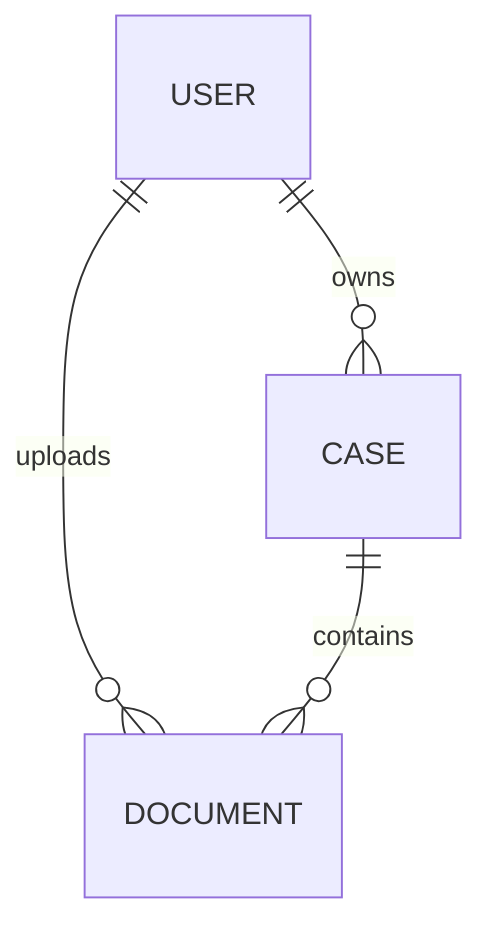

# Case and document model

## Step 1 — implement now

1. Replace the file-shaped job with a case owned by one user and documents with
   required case and uploader foreign keys. Every case has a required, nonblank
   name of at most 255 characters; the UI asks for it explicitly. A case holds at most two
   documents, a textual description and a sector map (see Document kinds); documents cannot be reassigned. Owner-only API access applies to both entities.
2. Store lifecycle milestones and generate status in PostgreSQL. Case milestones:
   submitted, processing started, mapping started, mapped, review started, approved,
   export started, exported. Document milestones: uploaded, extraction started,
   extracted. Status is read-only, not a second writable source of truth.
3. Add named checks for nonblank filenames up to 255 characters, nonblank storage
   identifiers, unique `(storage_bucket, storage_key)`, ordered milestones,
   extraction/mapping result references, and paired approval timestamp/actor.
   File size is nullable; known sizes must be positive. No database size ceiling.
   Existing upload transport limits remain separate from the persistence model.
4. Use database guards and parent-row locks to freeze document membership and source
   metadata at submission, require uploaded documents before submission, require
   extracted documents before mapping, and freeze content after approval. Export
   milestone updates remain allowed after approval. Milestones cannot be erased or
   rewritten; owners and document attribution cannot change. Approval requires
   review and belongs to the case's immutable mapping result.
5. Keep `/dokumenty` and its document card layout; add `/pripady` for grouped cases.
   Make batch uploads create one case. Register a document once and request fresh
   upload tickets for the same document on retry. Submission checks S3 object sizes and pins source versions,
   then invokes ingest after commit. Ingest extracts all documents before invoking mapping.
   Processing reads the pinned source version, never a mutable latest S3 object.
6. Start the new model without backward compatibility. Clear old jobs and uploaded
   objects explicitly before deployment; migration requires an empty jobs table and
   does not backfill cases, documents or upload timestamps. Historical migrations
   remain unchanged. Every document records its storage bucket and MIME type;
   completed uploads require a source version. No latest-object download fallback.
7. Verify migrations against PostgreSQL and retain production HTTP/session tests
   for owner-only case access, persistence/restarts and outage recovery. Run repository
   checks and production tests.

## Step 2 — deliberately deferred

Add extraction, mapping, and export attempts with start/completion/failure timestamps,
error details, mutually exclusive terminal outcomes, and references to their outputs.
Use the current attempt for failure/in-progress presentation and retain historical
attempts. No misleading permanent `failed` milestone is added to cases/documents now.
Processing/review/export workers and UI remain future work; their data invariants
are enforced now. Cross-document counters/readiness belong in queries, not generated
columns. Approved cases cannot be remapped or edited; revisions are outside step 1.

## Migration tooling

Drizzle generates tables, checks, generated status columns, indexes, foreign keys,
and migration metadata. One draft migration includes the schema DDL, an empty-jobs
guard before dropping the old table, and lifecycle triggers. The guard and triggers
are handwritten SQL because they cannot be expressed as row CHECK constraints.
The consolidated migration retains one generated snapshot for future schema diffs.

## Document kinds

A case describes one specimen read from two scans, which the hospital calls the
textual description and the sector map. `documents.kind` carries that distinction as
`text_description` or `sector_map`, and the pair `(case_id, kind)` is unique, so a case holds at
most one of each. The document guard refuses a third document on insert, under the
parent-row lock it already takes, and the API rejects the same registration with a
conflict before it reaches the constraint.

The uploader says which scan is which: the upload form has one slot per kind, and
`document.register` requires `kind` and stores it on insert. A repeat registration of
the same document must match on kind, and `kind` is immutable once set and never null.
Nothing is inferred from the scan's content.

Uploads are JPEG and nothing else, down to the `documents_content_type` check. Both
scans come off the hospital's scanner as single-frame 300 DPI JPEG, so every document
is one page, and extraction carries no path for embedded PDF text that no upload can
reach. Neither rule tolerates older rows: the migration that introduced them wiped
every case holding a document of another type or of no kind, documents included.

Ingest routes on the kind through one map, `extractors`, from `DocumentKind` to an
extractor: a `text_description` goes to `extractDocument` (Tesseract), a `sector_map` to
`extractSectorSheet` (OpenCV only, no reader and no model); both write the same
`derived/{id}/document.json`. A page that is not the sheet fails the extraction, and a
case cannot be submitted without its report (`cases_report_uploaded`), so a wrongly
filed or missing upload stops the case rather than mapping as nothing.

The sheet's reading is structured end to end. `sectorMap` carries one entry per pen
mark with the sectors it touches, as ids from the shared `SectorId` enum in contracts;
`regionFromSectorId` converts it to the record's REDCap `RegionCode`. The prompt reads
report text before sheet marks. The report determines the lesion count. A single
lesion receives every marked region; with several lesions, mapping preserves the
model's placement and reports any unplaced regions in diagnostics. The sheet never
adds a lesion.
