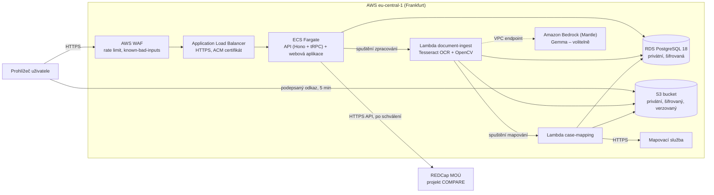

# ProstaPaper – dokumentace pro nemocniční IT a DPO

ProstaPaper je **funkční prototyp nasazený v AWS Frankfurt (eu-central-1)**. Podle pravidel Rakathonu jej provozujeme výhradně se syntetickými a anonymizovanými daty. Dokument je určen správcům IT, bezpečnostnímu týmu a pověřenci pro ochranu osobních údajů (DPO) MOÚ. Popisuje skutečný stav kódu a infrastruktury k 17. 10. 2026 a konkrétní kroky, které zbývají do ostrého provozu.

---

## Shrnutí

**Co je hotové a ověřené**

- Kompletní tok **sken → OCR → čtení sektorové mapy → návrh záznamu → schválení lékařem → import do REDCap** běží v produkčně nastavené infrastruktuře.
- **Data jsou uložena v EU.** Aplikace, databáze, úložiště dokumentů i OCR běží v AWS Frankfurt. Všude je vynucené šifrování při přenosu (TLS 1.3 / 1.2) i v klidu (AES‑256).
- **Bez lékaře se nic nezapíše.** Schválení je jediná cesta do registru a databáze schválený obsah fyzicky uzamkne. Každé schválení i export se zapisuje do auditní stopy.
- **Infrastruktura je celá v Terraformu.** CI/CD běží přes GitHub Actions s OIDC (bez uložených klíčů); nasazení probíhá s kontrolou zdraví a automatickým návratem k předchozí verzi.
- **Kvalita je měřená.** 116 ze 120 automatických testů prochází; zbylé 3 selhávají jen na Windows a 1 je přeskočený. Chybovost OCR je 1,59 % znaků na sedmi nemocničních skenech (viz [kap. 12](#12-ověření-kvality)).

**Co zbývá do ostrého provozu** (podrobně v [kap. 15](#15-cesta-k-ostrému-provozu))

| Krok                                                                                                                 | Typ práce           |
| -------------------------------------------------------------------------------------------------------------------- | ------------------- |
| Zpracování textu jazykovým modelem v EU: DPA a EU data residency u poskytovatele modelu, nebo model v Amazon Bedrock | konfigurace / vývoj |
| Retence a mazání dokumentů po exportu                                                                                | konfigurace + vývoj |
| Pseudonymizace identifikátorů a vazba na ID pacienta v registru                                                      | vývoj               |
| Přihlášení přes nemocniční identitu (SSO, MFA), vypnutí registrace a hostů                                           | vývoj               |
| Zpřísnění provozních nastavení (oprávnění CI, alarmy, zálohy)                                                        | konfigurace         |

---

## 1. Účel systému a zamýšlené použití

ProstaPaper je **asistent pro zadávání dat do výzkumného registru REDCap COMPARE**. Registr slouží k porovnání nálezů magnetické rezonance s výslednou histologií po radikální prostatektomii a dává zpětnou vazbu radiologům, urologům i patologům. Z naskenovaného histologického nálezu a ručně značené sektorové mapy systém připraví návrh záznamu. Lékař jej zkontroluje, schválí a odešle.

- Systém **nestanovuje diagnózu ani nedoporučuje léčbu**. Pracuje s hotovým nálezem patologa a výsledek slouží registru.
- Každý záznam musí před odesláním ověřit a schválit člověk. Automatické odeslání neexistuje.
- V rámci Rakathonu jde o prototyp, nikoli o zdravotnický prostředek. Kvalifikaci pro ostrý provoz podle MDR (vodítko MDCG 2019‑11) a zařazení podle AI Act musí potvrdit MOÚ (regulatorní oddělení / DPO). Podklady k tomu jsou v [kap. 6](#6-ai-act-lidský-dohled-a-vysvětlitelnost).

## 2. Architektura

_Diagram ukazuje cílovou síťovou topologii: mapování volá jazykový model přímo přes privátní interface endpoint, bez NAT gateway. Dokud toto přepojení neproběhne (viz [kap. 15](#15-cesta-k-ostrému-provozu), Fáze 1), reálný provoz mapování jde přes NAT gateway._

| Komponenta | Technologie                                        | Parametry                                                                                                                                                  |
| ---------- | -------------------------------------------------- | ---------------------------------------------------------------------------------------------------------------------------------------------------------- |
| Vstup      | AWS WAF (regional) + Application Load Balancer     | 1000 požadavků / 5 min na IP, AWS Known Bad Inputs; HTTP se přesměruje na HTTPS; TLS policy `ELBSecurityPolicy-TLS13-1-2-2021-06`                          |
| Aplikace   | ECS Fargate, jeden Docker image (Node 22)          | 0,5 vCPU / 1 GB. Kontejner běží jako neprivilegovaný uživatel (UID 1000) s read-only souborovým systémem a bez Linux capabilities                          |
| Databáze   | Amazon RDS PostgreSQL 18.6, `db.t4g.micro`         | Privátní subnety, šifrované úložiště, vynucené TLS (`rds.force_ssl=1`), aplikace ověřuje certifikát (`verify-full`), ochrana proti smazání                 |
| Úložiště   | Amazon S3                                          | Blokovaný veřejný přístup, vypnuté ACL, šifrování SSE-S3, verzování, odmítnutí přenosu bez TLS, CORS jen pro doménu aplikace                               |
| Extrakce   | AWS Lambda `document-ingest` (Node 22, arm64)      | 3008 MB, timeout 10 min, privátní subnety. Odchozí provoz jen do RDS, na S3 (gateway endpoint) a na Bedrock (interface endpoint), bez přístupu na internet |
| Mapování   | AWS Lambda `case-mapping`                          | 512 MB, timeout 10 min, privátní subnety, odchozí HTTPS přímo k jazykovému modelu (cílově přes interface endpoint)                                         |
| Tajemství  | AWS Systems Manager Parameter Store (SecureString) | Viz [kap. 9.3](#93-tajemství)                                                                                                                              |
| Logy       | Amazon CloudWatch Logs                             | Retence 7 dní                                                                                                                                              |
| DNS        | Vercel DNS                                         | CNAME na load balancer a validace certifikátu; neprochází jím žádná data aplikace                                                                          |

### 2.1 Průběh zpracování

1. Prohlížeč založí případ a pro každý soubor získá od API **jednorázový podepsaný odkaz** (platnost 5 minut, pevně daný typ `image/jpeg` a přesná velikost). Soubor se nahraje **přímo do S3**; přístupové údaje k úložišti prohlížeč nikdy nedostane.
2. Při odeslání případu API ověří v S3 velikost a verzi každého souboru, **uzamkne dokumenty na tuto verzi** a spustí zpracování.
3. `document-ingest` čte přesně uzamčenou verzi souboru. Nález přečte přes OCR, sektorovou mapu přes OpenCV a výsledek uloží zpět do S3.
4. `case-mapping` z přečteného textu sestaví záznam: tři nezávislé průchody modelu se sloučí většinovým hlasováním a sektory se převezmou z mapy.
5. Lékař záznam zkontroluje a schválí. Po závěrečné kontrole API odešle záznam do REDCap a uloží přidělené ID.

Stav případu a dokumentu se odvozuje z časových razítek. Přechody hlídají **triggery přímo v databázi**: milníky nelze přepsat, schválený případ ani jeho dokumenty nelze měnit a exportovaný případ je neměnný. Pravidla tak platí i pro ruční zásahy do databáze, ne jen pro aplikaci.

## 3. Zpracovávaná data a jejich umístění

| Data                                           | Kde                         | Region                 | Šifrování                                | Retence (dnes)                                                                                                     |
| ---------------------------------------------- | --------------------------- | ---------------------- | ---------------------------------------- | ------------------------------------------------------------------------------------------------------------------ |
| Naskenované dokumenty (JPEG)                   | S3 `uploads/`               | eu-central-1           | AES‑256, TLS                             | Bez omezení, včetně verzí                                                                                          |
| Přečtený text a výsledek čtení mapy            | S3 `derived/`               | eu-central-1           | AES‑256, TLS                             | Bez omezení                                                                                                        |
| Navržený záznam                                | S3 `mapping/`               | eu-central-1           | AES‑256, TLS                             | Bez omezení                                                                                                        |
| Název případu, názvy souborů, stavy, REDCap ID | RDS, schéma `app`           | eu-central-1           | Šifrované úložiště, TLS                  | Bez omezení; případ odeslaný ke zpracování nelze smazat                                                            |
| Auditní události                               | RDS `app.case_audit_events` | eu-central-1           | Šifrované úložiště, TLS                  | Bez omezení                                                                                                        |
| Uživatelské účty a relace                      | RDS, schéma `auth`          | eu-central-1           | Šifrované úložiště; hesla jsou hashovaná | Bez omezení                                                                                                        |
| Přečtený text při mapování                     | Mapovací služba             | podle nastavení služby | TLS                                      | Podle smluvních podmínek (viz kap. 4)                                                                              |
| Schválený záznam                               | REDCap MOÚ                  | infrastruktura MOÚ     | HTTPS                                    | Podle pravidel registru                                                                                            |
| Aplikační logy                                 | CloudWatch                  | eu-central-1           | Šifrování AWS                            | 7 dní. Aplikace záměrně loguje identifikátory, ne obsah nálezu; neošetřená výjimka ale může obsahovat fragment dat |
| Zálohy databáze                                | RDS                         | eu-central-1           | Šifrované                                | 1 den + finální snapshot                                                                                           |

**Osobní údaje v názvech:** název případu a názvy souborů jsou volný text a název případu se vkládá i do názvu souboru. Do názvu se proto **nesmí** zadávat jméno, rodné číslo ani číslo pojištěnce. Toto pravidlo je zatím organizační; technické vynucení je součástí [kap. 15](#15-cesta-k-ostrému-provozu).

**Přístup k datům:** uživatel vidí jen případy, které založil, a případy, ke kterým mu vlastník výslovně přidělil přístup (role Kontrolující nebo Čtenář, tabulka `app.case_members`). Přístup k souboru je vždy jen přes krátkodobý (5 minut) podepsaný odkaz na konkrétní objekt, který vybírá server.

## 4. Zpracovatelé a přenosy dat

| Zpracovatel                                           | Účel                                    | Data                                       | Umístění                                                                    |
| ----------------------------------------------------- | --------------------------------------- | ------------------------------------------ | --------------------------------------------------------------------------- |
| Amazon Web Services                                   | Hosting, databáze, úložiště, OCR, logy  | Vše v kap. 3                               | eu-central-1 (Frankfurt)                                                    |
| Poskytovatel jazykového modelu                        | Sestavení záznamu z textu               | Přečtený text nálezu a výsledek čtení mapy | Region podle nastavení projektu; bez EU data residency jde o přenos mimo EU |
| MOÚ – REDCap                                          | Cílový registr                          | Schválený záznam                           | Infrastruktura MOÚ                                                          |
| Amazon Bedrock (volitelně, ve výchozím stavu vypnuto) | Alternativní přepis skenu modelem Gemma | Obraz stránky nálezu                       | eu-central-1, přes privátní VPC endpoint                                    |
| GitHub, Vercel                                        | Zdrojový kód a CI/CD, DNS               | Žádná pacientská data                      | –                                                                           |

**Jazykový model a GDPR.** Ve verzi pro Rakathon využívá mapovací služba jazykový model, protože pracujeme jen se syntetickými daty. Konkrétní poskytovatel, region zpracování, retence a podmínky použití dat pro trénování musí být doloženy v provozní evidenci a před ostrým provozem ověřeny DPO. Pro ostrý provoz jsou zvažovány dvě cesty:

1. **Jazykový model se zpracováním v EU, nulovou retencí a zpracovatelskou smlouvou (DPA).** Splnění těchto požadavků je třeba smluvně doložit a ověřit v nastavení služby. Při zachování kompatibilního API se mění projekt a klíč v SSM.
2. **Model v Amazon Bedrock ve Frankfurtu.** AWS uvádí, že [Bedrock prompty a výstupy neukládá a nepoužívá k trénování](https://docs.aws.amazon.com/bedrock/latest/userguide/data-protection.html). Infrastruktura k tomu už je připravená: privátní VPC endpoint, oprávnění a token pro Bedrock Mantle používá extrakce. Mapování je potřeba přepojit na tento endpoint.

Konkrétní znění podmínek musí před ostrým provozem ověřit DPO.

## 5. Zabezpečení

### 5.1 Síť

- VPC `10.42.0.0/16`: veřejné subnety pro load balancer a aplikační kontejner, privátní subnety pro databázi a Lambdy.
- Aplikační kontejner přijímá spojení **pouze z load balanceru**; veřejnou IP využívá jen pro odchozí provoz (REDCap, AWS API).
- Databáze přijímá spojení jen od aplikace a obou Lambd a není dostupná z internetu.
- Lambdy nemají žádný příchozí přístup. Extrakce nemá přístup na internet vůbec; mapování jen odchozí HTTPS k jazykovému modelu.

### 5.2 Identity a oprávnění

- Aplikační role ECS smí v bucketu dokumentů číst pod `uploads/`, `derived/` a `mapping/` a zapisovat jen pod `uploads/`.
- Obě Lambdy mají vlastní role, každá s oprávněními jen pro svou část úložiště, své tajemství a potřebnou službu.
- Nasazení z GitHub Actions používá OIDC bez dlouhodobých klíčů a je omezené na větev `main`. Pro hackathon mají pipeline role `AdministratorAccess`; zúžení je v [kap. 15](#15-cesta-k-ostrému-provozu).

### 5.3 Aplikace

- **Přihlášení:** [Better Auth](https://www.better-auth.com/), e-mail a heslo (8–128 znaků), relace v HTTP cookie. Role `reviewer` a `admin`. Hostovský účet pro předvádění.
- **Ochrana přihlášení:** kontrola hlavičky `Origin`, limity pokusů na IP (registrace 5 / min, přihlášení 30 / min, host 5 / min), WAF před aplikací.
- **Řízení přístupu k případům:** každý dotaz je omezen na vlastníka a uživatele s přiděleným přístupem. Oprávnění podle role:

  | Akce                                           | Vlastník | Kontrolující | Čtenář |
  | ---------------------------------------------- | -------- | ------------ | ------ |
  | Prohlížet dokumenty a výsledky                 | ✅       | ✅           | ✅     |
  | Zahájit kontrolu, schválit, vrátit ke kontrole | ✅       | ✅           | –      |
  | Odeslat do REDCap                              | ✅       | –            | –      |
  | Sdílet případ                                  | ✅       | –            | –      |

  Role se ověřují na serveru při zamčení případu v databázi, ne jen v rozhraní. Identita toho, kdo akci provedl, se předává databázi (`app.actor_id`) a zapisuje do auditu.

- **Seznam uživatelů při sdílení:** dialog **Sdílet** zobrazí vlastníkovi případu jména a e-maily všech aktivních uživatelů aplikace. V nemocničním nasazení jde o interní adresář zaměstnanců; DPO by měl tento rozsah posoudit.
- **Integrita:** databázová omezení a triggery hlídají pořadí kroků, neměnnost schváleného a exportovaného obsahu a vazbu dokumentu na uzamčenou verzi souboru.
- **Export do REDCap:** případ se před síťovým voláním zamkne, payload se jednou serializuje a uloží se jeho otisk SHA‑256. Import se **nikdy automaticky neopakuje**, čímž se snižuje riziko vzniku duplicitních záznamů při opakovaném odeslání. Chybové odpovědi REDCap se nelogují, protože mohou obsahovat token nebo klinický obsah.
- **Chybové odpovědi API** neobsahují interní detaily ani stack trace.

### 5.4 Audit

Tabulka `app.case_audit_events` zaznamenává schválení, zrušení schválení a průběh exportu (zahájení, připravený payload s otiskem, potvrzení s REDCap ID, nepotvrzený výsledek), vždy s aktérem a časem. Schválení zapisují databázové triggery, takže je nelze obejít.

## 6. AI Act, lidský dohled a vysvětlitelnost

| Požadavek                   | Jak jej ProstaPaper řeší                                                                                                                                                                                                                                                        |
| --------------------------- | ------------------------------------------------------------------------------------------------------------------------------------------------------------------------------------------------------------------------------------------------------------------------------- |
| **Lidský dohled**           | Návrh AI nikdy nejde do registru bez schválení lékařem. Schválit může vlastník nebo druhý lékař s rolí Kontrolující (princip čtyř očí). Schválení lze před odesláním zrušit; po něm je obsah v databázi uzamčen.                                                                |
| **Transparentnost**         | Uživatel ví, že pracuje s návrhem AI. U strukturovaného záznamu se zobrazuje název modelu a dokumentace popisuje úlohu použitých modelů a jejich omezení. Originální sken i přečtený text jsou vždy k dispozici pro porovnání.                                                  |
| **Záznamy o činnosti**      | Auditní stopa schválení a exportu s otiskem odeslaných dat. Diagnostika každého mapování: model, počet průchodů, spotřeba tokenů, pole, ve kterých se průchody neshodly.                                                                                                        |
| **Přesnost a robustnost**   | Výstup musí projít validací proti číselníkům a pravidlům registru; porušení musí model opravit. Tři nezávislé průchody se slučují většinovým hlasováním. Sektory se čtou deterministicky počítačovým viděním, bez jazykového modelu. Kvalitu OCR měří testovací sada (kap. 12). |
| **Omezení halucinací**      | Model má pokyn vyplnit jen hodnoty dohledatelné ve zprávě, nic nedopočítávat a ponechat chybějící údaje prázdné. Počet ložisek určuje jen text, značky na mapě nová ložiska nevytvoří.                                                                                          |
| **Kybernetická bezpečnost** | Viz kap. 5.                                                                                                                                                                                                                                                                     |

**Vysvětlitelnost dnes a v další verzi:** lékař dnes porovnává celý záznam s originálem a s přečteným textem. Zobrazení míry jistoty a citace zdrojové věty u každého pole, spolu s úpravou polí přímo v aplikaci, je ve vývoji.

## 7. Autentizace a správa uživatelů

| Funkce                                  | Stav                                                           |
| --------------------------------------- | -------------------------------------------------------------- |
| Přihlášení e-mailem a heslem            | ✅                                                             |
| Role `reviewer` / `admin`               | ✅ v databázi; rozhraní pro správu uživatelů zatím chybí       |
| Sdílení případu (Kontrolující, Čtenář)  | ✅; odebrání přístupu zatím chybí                              |
| Založení účtů správcem                  | ✅ skriptem `pnpm --filter @prostapaper/api seed:users`        |
| Hostovský přístup a otevřená registrace | zapnuto pro předvádění; před ostrým provozem vypnout           |
| Obnova hesla                            | plánováno (v rozhraní zatím není samoobslužná ani správcovská) |
| SSO (AD / Entra ID) a MFA               | plánováno                                                      |

## 8. Napojení na REDCap

- Cíl: `REDCAP_API_URL` (výchozí `https://redcap.mou.cz/api/`). API ověří, že token patří **projektu 64 (COMPARE)** a že je zapnuté automatické číslování záznamů. S jiným projektem odmítne pracovat.
- Token: 32 hexadecimálních znaků v SSM, do kontejneru se předává odkazem.
- Import: formulář `surgery_c61` a opakovaný formulář `surgery_c61_resected_lesion` s jednou instancí na každé ložisko. Formuláře se označí jako dokončené.
- **Identifikace pacienta:** záznam dnes vzniká pod **novým ID**, které přidělí REDCap (`forceAutoNumber`). Systém nepřebírá identifikátor pacienta z dokumentů a nedoplňuje existující záznam. Vazba na existující ID v registru je součástí [kap. 15](#15-cesta-k-ostrému-provozu).
- Komunikace: jen HTTPS, přesměrování zakázaná, timeout 15 s na volání a 45 s na celý export.
- Síť: požadavek odchází z veřejné IP aplikace v AWS. REDCap musí být z AWS dostupný, buď povolením IP, nebo přes VPN.
- Volitelně `REDCAP_GATEWAY_COOKIE_FILE`: průchod síťovou bránou před REDCap pomocí cookies (povolené jsou jen `BNIS_*` a `x-bni-*`). Pro ostrý provoz jej doporučujeme nahradit síťovým povolením.
- **Nepotvrzený export:** pokud REDCap neodpoví včas, nelze vědět, zda záznam vznikl. Systém pak případ zablokuje, místo aby riskoval duplicitu. Správce ověří stav v REDCap a případ uvolní; zatím ručně v databázi.

## 9. Nasazení

Celá infrastruktura je popsána v Terraformu. Postup s příkazy je v [`infra/README.md`](../../infra/README.md).

### 9.1 Předpoklady

- AWS účet s přístupem do regionu eu-central-1,
- Terraform `~> 1.16.0`, AWS provider `~> 6.0`,
- Node.js **22.23.3** a pnpm **12.8.1** (verze jsou vynucené),
- Docker s buildx (image `linux/amd64`),
- správa DNS cílové domény.

### 9.2 Struktura

| Adresář                       | Obsah                                                                                        |
| ----------------------------- | -------------------------------------------------------------------------------------------- |
| `infra/bootstrap/`            | Bucket se stavem Terraformu, OIDC role pro GitHub, role pro ECS. Aplikuje se jednou ručně.   |
| `infra/environments/demo/`    | VPC, NAT, ECR, ECS, RDS, load balancer, WAF, certifikát, S3, obě Lambdy, VPC endpointy, logy |
| `infra/docker/Dockerfile`     | Produkční image: API, frontend, SQL migrace, ověřený CA certifikát RDS                       |
| `.github/workflows/check.yml` | Kontroly, smoke testy kontejneru, validace Terraformu, nasazení z `main`                     |

Pro účet MOÚ se mění: `allowed_account_ids` v `main.tf`, `site_hostname` ve `variables.tf`, název bucketu (obsahuje ID účtu), vzor `image_uri` v `ecs.tf` a prefix parametrů `/prostapaper/demo/`.

### 9.3 Tajemství

| Parametr (SSM SecureString)            | Použití                                                        |
| -------------------------------------- | -------------------------------------------------------------- |
| `/prostapaper/demo/BETTER_AUTH_SECRET` | Podpis relací (min. 32 znaků; změna odhlásí všechny uživatele) |
| `/prostapaper/demo/DB_PASSWORD`        | Heslo aplikačního účtu `prostapaper_app`                       |
| `/prostapaper/demo/REDCAP_API_TOKEN`   | Token REDCap API                                               |
| Přístupový klíč mapovací služby v SSM  | Klíč jazykového modelu; Lambda jej čte za běhu                 |

ECS předává tajemství kontejneru odkazem, takže hodnoty nejsou v Terraformu. Výjimkou je `DB_PASSWORD`, které Terraform předává Lambdě `document-ingest` jako proměnnou prostředí, takže je uložené ve stavu Terraformu (v šifrovaném bucketu). Hlavní heslo databáze spravuje AWS Secrets Manager a aplikace jej nepoužívá.

### 9.4 Konfigurace

**API (ECS):**

| Proměnná                                                           | Povinná | Význam                                                          |
| ------------------------------------------------------------------ | ------- | --------------------------------------------------------------- |
| `BETTER_AUTH_SECRET`, `BETTER_AUTH_URL`                            | ano     | Podpis relací a veřejná adresa aplikace                         |
| `S3_DOCUMENT_BUCKET`                                               | ano     | Bucket dokumentů                                                |
| `DOCUMENT_INGEST_FUNCTION`                                         | ano     | Název Lambdy `document-ingest`                                  |
| `PGHOST`, `PGPORT`, `PGDATABASE`, `PGUSER`, `PGPASSWORD`           | ano     | Připojení k PostgreSQL                                          |
| `PGSSLMODE`, `NODE_EXTRA_CA_CERTS`                                 | ano     | `verify-full` a CA certifikát RDS                               |
| `REDCAP_API_TOKEN`, `REDCAP_API_URL`, `REDCAP_GATEWAY_COOKIE_FILE` | ne      | Export do REDCap (bez tokenu je vypnutý)                        |
| `AWS_REGION`, `PORT`, `NODE_ENV`, `MIGRATIONS_DIR`                 | ne      | Výchozí `eu-central-1`, `3000`, `development`, cesta k migracím |

**Lambda `document-ingest`:** připojení k PostgreSQL, `CASE_MAPPING_FUNCTION`, `EXTRACTION_READER` (`tesseract` nebo `bedrock-mantle`, výchozí `tesseract`), `EXTRACTION_MODEL` (výchozí `google.gemma-4-e2b`).

**Lambda `case-mapping`:** připojení k PostgreSQL, odkaz na SSM parametr s přístupovým klíčem modelu podle konfigurace nasazení, `MAPPING_PASSES` (1–9, výchozí 3), `MAPPING_MODEL` (model podle konfigurace mapovací služby).

### 9.5 CI/CD, migrace a návrat k předchozí verzi

- Každá změna v `main` projde kontrolami typů, lintem, testy, hranicemi mezi balíčky a validací Terraformu. Následuje sestavení image s neměnným digestem, smoke test a aplikace uloženého plánu Terraformu.
- ECS spustí novou instanci a starou zastaví až po kontrole zdraví. Při selhání se automaticky vrátí k předchozímu nasazení.
- Návrat k libovolné předchozí verzi: workflow **check** → **Run workflow** s parametrem `image_digest`.
- Migrace databáze spouští API při startu, ještě před přijetím prvního požadavku. Pokud migrace selže, nová verze se nespustí a provoz zůstane na předchozí.

## 10. Hybridní a on-premise varianta

| Vrstva                | Přenositelnost                                                             |
| --------------------- | -------------------------------------------------------------------------- |
| Webová aplikace + API | Jeden Docker image, lze provozovat na serveru MOÚ s PostgreSQL 18          |
| Databáze              | Standardní PostgreSQL, migrace v čistém SQL                                |
| Úložiště              | Libovolné S3 kompatibilní úložiště s verzováním                            |
| OCR a čtení mapy      | Tesseract a OpenCV běží lokálně (WebAssembly), bez síťových závislostí     |
| Spouštění zpracování  | Dnes AWS Lambda; pro on-premise je třeba zabalit jako kontejnerové workery |
| Jazykový model        | Modelová služba, Amazon Bedrock, nebo model v síti MOÚ (vyžaduje úpravu)   |

**Hybridní varianta** (aplikace v AWS Frankfurt a VPN do sítě MOÚ k REDCap) vyžaduje jen síťovou konfiguraci. **Plně on-premise varianta** vyžaduje převést zpracování z Lambd na workery.

## 11. Provoz a monitoring

- **Zdraví:** `GET /api/health` (proces běží) a `GET /api/ready` (dostupnost databáze).
- **Logy:** CloudWatch `/ecs/prostapaper-demo`, `/aws/lambda/prostapaper-demo-document-ingest`, `/aws/lambda/prostapaper-demo-case-mapping` a log PostgreSQL.
- **Alarmy:** u databáze jsou definované alarmy na volné místo, paměť a počet spojení; notifikace se nastavují při předání do provozu.
- **Zálohy:** automatické zálohy RDS (1 den) a finální snapshot při rušení prostředí.
- **Dostupnost:** jedna instance aplikace a databáze v jedné zóně, což je dimenzováno pro pilotní provoz.

### 11.1 Chybové stavy a jejich řešení

| Stav                                                        | Příčina                                           | Řešení                                                                                                      |
| ----------------------------------------------------------- | ------------------------------------------------- | ----------------------------------------------------------------------------------------------------------- |
| Dokument zůstává ve stavu **extrakce**                      | Extrakce selhala i po 2 automatických opakováních | Zkontrolovat log `document-ingest` a znovu spustit Lambdu s `{"caseId": "…"}`; hotové dokumenty se přeskočí |
| Případ zůstává ve stavu **ve frontě** nebo **mapování**     | Selhalo mapování (např. nedostupné API modelu)    | Zkontrolovat log `case-mapping` a znovu spustit Lambdu s `{"caseId": "…"}`                                  |
| Export je **nepotvrzený**                                   | REDCap neodpověděl včas                           | Ověřit v REDCap, zda záznam vznikl, a podle toho stav případu uvolnit                                       |
| Odeslání případu hlásí „Could not start document ingestion“ | Selhalo spuštění zpracování                       | Uživatel případ odešle znovu; spuštění se zopakuje                                                          |

Ruční zásahy musí respektovat databázové triggery: milníky nelze přepisovat a exportovaný případ je neměnný.

## 12. Ověření kvality

**Automatické testy** (stav ke 17. 10. 2026):

| Oblast                                  | Testy                                                                                   |
| --------------------------------------- | --------------------------------------------------------------------------------------- |
| Kontrakty, číselníky REDCap, sektory    | 28                                                                                      |
| Čtení sektorové mapy, OCR, pořadí čtení | 30                                                                                      |
| Mapování a většinové hlasování          | 11                                                                                      |
| API, klient REDCap, úložiště            | 27                                                                                      |
| Extrakce v Lambdě a QA nástroje         | 9                                                                                       |
| Webová aplikace (párování dávek)        | 10                                                                                      |
| Databáze a spouštění mapování           | 5                                                                                       |
| **Celkem**                              | **120**: 116 prošlo, 3 selhávají jen na Windows (oprávnění souborů, shell), 1 přeskočen |

V CI se navíc před každým nasazením spouštějí integrační testy produkčního kontejneru proti PostgreSQL: celý tok zpracování, export, oddělení dat mezi uživateli, sdílení případů podle rolí a výpadek a obnova databáze.

**Přesnost OCR** na sedmi nemocničních skenech (porovnání s referenčním přepisem, metodika v [`qa/README.md`](../../qa/README.md)):

| Metoda                  | Chybovost znaků (CER) | Chybovost slov (WER) |
| ----------------------- | --------------------- | -------------------- |
| **Tesseract (použitý)** | **1,59 %**            | **5,79 %**           |
| Gemma 4 E2B (Bedrock)   | 37,95 %               | 50,26 %              |

Šest ze sedmi skenů má chybovost znaků pod 1 %; celkový výsledek zhoršuje jeden sken (10,62 %). Jde o malou sadu, výsledek proto nelze zobecnit, ale potvrzuje volbu Tesseractu. Přesnost vyplnění jednotlivých polí registru změří pilot (kap. 15).

## 13. Použité komponenty a licence

| Komponenta                                    | Verze      | Licence                         | Použití                     |
| --------------------------------------------- | ---------- | ------------------------------- | --------------------------- |
| Tesseract.js / tesseract.js-core              | 7.0.0      | Apache-2.0                      | OCR                         |
| Český model Tesseract (`ces`, tessdata_best)  | 4.0.0      | Apache-2.0                      | OCR                         |
| OpenCV.js (`@techstark/opencv-js`)            | 5.0.0      | Apache-2.0                      | Čtení sektorové mapy        |
| **MuPDF**                                     | 1.28.1     | **AGPL-3.0**                    | Načtení a vykreslení obrazu |
| SDK klient jazykového modelu                  | 7.32       | Apache-2.0                      | Volání jazykového modelu    |
| AWS SDK, Bedrock token generator              | 3.x, 1.1   | Apache-2.0                      | Služby AWS                  |
| Hono, tRPC, Better Auth, Zod, React, TanStack | aktuální   | MIT                             | API, přihlášení, rozhraní   |
| Drizzle ORM                                   | 0.45       | Apache-2.0                      | Přístup k databázi          |
| PostgreSQL klient (`pg`), Kysely              | 8.23, 0.29 | MIT                             | Databáze                    |
| Jazykový model pro strukturování nálezu       | –          | Komerční podmínky poskytovatele | Sestavení záznamu           |
| Gemma 4 E2B (volitelně)                       | –          | Gemma Terms of Use              | Alternativní OCR            |

**MuPDF je pod licencí AGPL-3.0.** Při provozu aplikace jako síťové služby a při jejím šíření dalším centrům AGPL vyžaduje zpřístupnit uživatelům zdrojový kód. Alternativou je komerční licence od Artifex. Další možnost je nahradit MuPDF knihovnou s permisivní licencí, protože aplikace dnes zpracovává jen JPEG.

## 14. Náklady

Orientační odhad pro současné prostředí při nízkém vytížení, ceník AWS eu-central-1, bez DPH. Ověřte v [AWS Pricing Calculator](https://calculator.aws/).

| Položka                                              | Měsíčně                                                             |
| ---------------------------------------------------- | ------------------------------------------------------------------- |
| Load balancer, ECS Fargate, WAF, veřejné IPv4 adresy | 60–70 USD                                                           |
| RDS `db.t4g.micro` + 20 GB úložiště                  | 15–20 USD                                                           |
| NAT gateway (odpadá při přechodu na Bedrock)         | 35–45 USD                                                           |
| **Fixní náklady celkem**                             | **≈ 110–135 USD**                                                   |
| Lambda, S3, CloudWatch                               | jednotky USD při stovkách případů                                   |
| Jazykový model                                       | podle spotřeby tokenů, kterou systém zaznamenává u každého mapování |

Centrum pro nádory prostaty MOÚ provádí podle veřejně uváděných údajů přibližně 200 radikálních prostatektomií ročně. **Fixní náklady pak vycházejí řádově na 7–8 USD na případ**; náklady na zpracování jednoho případu jsou proti tomu zanedbatelné. Stejná infrastruktura obslouží bez úprav řádově více případů, takže cena na případ klesá se zapojením dalších center nebo se zpracováním historického archivu.

## 15. Cesta k ostrému provozu

**Fáze 1 – konfigurace (bez změny kódu)**

| Krok                                                                                              | Výsledek                          |
| ------------------------------------------------------------------------------------------------- | --------------------------------- |
| Služba jazykového modelu se zpracováním v EU a nulovou retencí + DPA, nebo rozhodnutí pro Bedrock | Text zpracovaný v EU bez uchování |
| Pravidlo životního cyklu S3 pro mazání dokumentů a jejich verzí po stanovené době                 | Retence podle interních pravidel  |
| Zúžení oprávnění CI rolí, notifikace alarmů, delší retence záloh, případně Multi-AZ a klíče KMS   | Provozní standard nemocnice       |
| Síťové povolení nebo VPN k REDCap místo průchodu přes cookies                                     | Stabilní napojení registru        |

**Fáze 2 – vývoj**

| Krok                                                                                                                                    | Výsledek                                    |
| --------------------------------------------------------------------------------------------------------------------------------------- | ------------------------------------------- |
| Přebírání ID pacienta z dokumentů, kontrola shody nálezu a mapy, zápis k existujícímu záznamu v REDCap                                  | Splnění požadavku na jednotný identifikátor |
| Pseudonymizace identifikátorů před voláním modelu a technická kontrola názvu případu                                                    | Model nevidí přímé identifikátory           |
| Smazání dokumentů po potvrzeném exportu                                                                                                 | Data v cloudu jen po dobu zpracování        |
| Přihlášení přes nemocniční identitu (SSO, MFA), vypnutí registrace a hostů, odebírání přístupu a omezení adresáře uživatelů při sdílení | Řízení přístupu podle MOÚ                   |
| Úprava polí, míra jistoty a citace zdroje v kontrole; opakování zpracování z rozhraní                                                   | Rychlejší a průkaznější kontrola            |
| Mapování přes Amazon Bedrock (pokud bude zvoleno ve fázi 1)                                                                             | Celý tok v AWS Frankfurt                    |

**Fáze 3 – pilot**

Retrospektivní ověření na anonymizovaných případech, které už jsou v registru COMPARE zadané ručně. Pro každé pole se změří shoda s ručním zadáním a čas kontroly lékařem. Výsledek je podkladem pro rozhodnutí o rutinním provozu a pro regulatorní posouzení.
