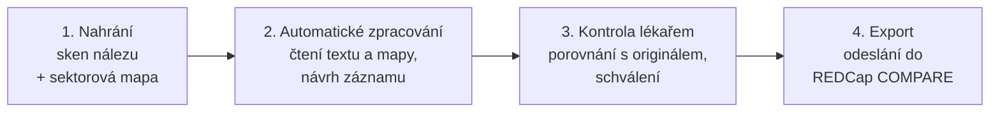

# ProstaPaper – příručka pro lékaře

ProstaPaper převádí papírový histologický nález po radikální prostatektomii a ručně zakreslenou sektorovou mapu prostaty do strukturovaného záznamu pro registr **REDCap COMPARE**. Umělá inteligence připraví návrh záznamu. **Do registru se ale nic nedostane, dokud jej lékař nezkontroluje a neschválí.**

> **Před prvním použitím**
>
> - ProstaPaper je funkční prototyp vytvořený pro Rakathon 2026, nikoli zdravotnický prostředek. Nahrávejte pouze **syntetické nebo anonymizované** dokumenty.
> - Do názvu případu **nikdy nevpisujte** jméno pacienta, rodné číslo ani číslo pojištěnce. Použijte interní kód případu.
> - Text nálezu se ke zpracování odesílá mapovací službě využívající jazykový model (viz [Použité modely](#7-použité-modely)). Podrobnosti o ochraně dat najdete v [dokumentaci pro IT a DPO](pro-it-a-dpo.md).

---

## 1. K čemu ProstaPaper slouží

Registr **COMPARE** porovnává nálezy magnetické rezonance s výslednou histologií po operaci. Radiolog se z něj dozví, zda MR popsala skutečnost, urolog, zda operace odstranila celý nádor, a patolog, zda odpovídal popis biopsie. Registr je také zdrojem dat pro studie (ProstaPilot, PRAISE‑U+) a pro interní validaci nástrojů AI. Patolog ale zakresluje ložiska na papír a nález píše volným textem, takže každý případ dnes někdo musí ručně přečíst, dohledat v zákresu a pole po poli přepsat do REDCap.

ProstaPaper tuto práci převezme:

- přečte text nálezu (Gleasonovo skóre, ISUP, pTNM, okraje, rozměry ložisek, perineurální a cévní invaze…),
- přečte sektorovou mapu a určí, do kterých sektorů prostaty patolog zakreslil ložiska,
- obojí spojí do návrhu záznamu ve tvaru formulářů **Surgery C61** a **Surgery C61 – resected lesion**,
- po vašem schválení záznam jedním kliknutím odešle do REDCap.

Lékař má vždy poslední slovo: aplikace nic neodesílá sama a schválený záznam už nelze změnit.

## 2. Jak to funguje – 4 kroky

| Krok          | Kdo    | Co se děje                                                                                                                                                     |
| ------------- | ------ | -------------------------------------------------------------------------------------------------------------------------------------------------------------- |
| 1. Nahrání    | lékař  | Nahrajete sken textového nálezu a (volitelně) sken sektorové mapy.                                                                                             |
| 2. Zpracování | systém | Text se přečte optickým rozpoznáváním (OCR). Zákres se porovná s prázdným formulářem a určí se zasažené sektory. Jazykový model z textu sestaví návrh záznamu. |
| 3. Kontrola   | lékař  | Porovnáte návrh s originálními dokumenty a schválíte ho.                                                                                                       |
| 4. Export     | lékař  | Po závěrečné kontrole záznam odešlete do REDCap. Případ se tím uzamkne.                                                                                        |

## 3. Přihlášení a orientace v aplikaci

Přihlaste se svým e-mailem a heslem. Pro ukázku lze použít **Pokračovat jako host**. Vidíte případy, které jste sami založili, a případy, které s vámi kolega sdílel (viz [kapitola 4.6](#46-sdílení-případu-s-kolegou)).

| Položka v postranním panelu | K čemu slouží                                                     |
| --------------------------- | ----------------------------------------------------------------- |
| **Nový případ**             | Nahrání dokumentů a spuštění zpracování                           |
| **Ke kontrole**             | Případy, které čekají na vaši kontrolu nebo ji máte rozpracovanou |
| **Případy**                 | Všechny vaše případy a jejich stav                                |
| **Dokumenty**               | Všechny nahrané dokumenty, náhled originálu a přečtený text       |
| **Exporty**                 | Případy odeslané do REDCap, včetně přiděleného REDCap ID          |
| **Dokumentace**             | Tato dokumentace                                                  |

V nabídce účtu (vlevo dole) přepnete světlý a tmavý režim a odhlásíte se.

## 4. Postup krok za krokem

### 4.1 Nový případ (jeden pacient)

1. Klikněte na **Nový případ** a ponechte režim **Jeden případ**.
2. Do pole **Textový popis** (povinné) vložte sken histologického nálezu.
3. Do pole **Sektorová mapa** (volitelné) vložte sken ručně zakresleného formuláře.
4. Zkontrolujte **Název případu**. Předvyplní se z názvu prvního souboru; nesmí obsahovat osobní údaje.
5. Klikněte na **Zahájit zpracování**.

Požadavky na soubory:

- formát **JPEG** (`.jpg`, `.jpeg`), nejvýše **20 MB** na soubor,
- jeden textový popis a nejvýše jedna sektorová mapa na případ,
- sken správně otočený a čitelný; sektorová mapa na tištěném formuláři, který MOÚ používá.

Pro vyzkoušení můžete zvolit **Vyberte ukázkový případ**.

### 4.2 Dávka (více pacientů najednou)

V režimu **Dávka** přetáhněte celou složku nebo více souborů najednou. Soubory se roztřídí a spárují podle názvu:

- `scan…` nebo `report…` = textový popis, `schema…` = sektorová mapa,
- k sobě patří soubory se stejným číslem na konci názvu (např. `Scan_0001.jpg` a `Schema_1.jpg`).

Před odesláním zkontrolujte tabulku párování a názvy případů. Nález bez mapy je v pořádku, protože mapa je volitelná. Aplikace vás ale upozorní na sektorovou mapu bez odpovídajícího nálezu, na duplicitní čísla a na soubory, jejichž název nerozpozná. Odeslání dávky je zablokované, dokud tyto chyby neopravíte. Případy se zpracovávají postupně. Úspěšně odeslané zmizí ze seznamu a neúspěšné v něm zůstanou k opakování.

### 4.3 Zpracování

Po odeslání se otevře detail případu s grafem **Průběh zpracování**. Stránka se aktualizuje sama, nemusíte ji obnovovat. Postupně uvidíte:

1. **Nahráno** – soubor je bezpečně uložen,
2. **Extrakce textu** – čte se text nálezu, případně zákres v mapě,
3. **Mapování záznamu** – z textu a mapy vzniká návrh záznamu,
4. **Záznam připraven** – případ se objeví v sekci **Ke kontrole**.

Přečtený text si můžete kdykoli prohlédnout v sekci **Dokumenty** (karta **Výstup extrakce**).

### 4.4 Kontrola záznamu

1. Otevřete případ ze sekce **Ke kontrole** a klikněte na **Zahájit kontrolu**.
2. Karta **Strukturovaný záznam** (s názvem modelu, který návrh připravil) ukazuje:
   - pole formuláře **Surgery C61** (typ operace, lymfadenektomie, počty uzlin, pT/pN/pM, R, L, V, ISUP, histologie, slovní nález),
   - **počet ložisek** a pro každé **ložisko** jeho sektory, histologický typ, rozměry, extrakapsulární šíření, perineurální invazi a Gleasonovy vzory s procenty,
   - **sektorovou mapu**, na které jsou ložiska vykreslena.
3. Porovnejte každou hodnotu s originálem. Originální sken otevřete z karty dokumentu v části **Dokumenty případu**.
4. Hodnota **Neuvedeno** znamená, že ji zpráva neobsahuje. Systém v takovém případě záměrně nic nedoplňuje.
5. Pokud vše souhlasí, klikněte na **Schválit**. Schválit může vlastník případu nebo kolega s rolí **Kontrolující**. Kontrolu tak lze svěřit druhému lékaři (princip čtyř očí).

> **Když návrh obsahuje chybu:** v této verzi nelze hodnoty v aplikaci opravit. Případ **neschvalujte**, ponechte jej ve stavu kontroly a údaje zapište do REDCap ručně, nebo kontaktujte správce aplikace. Úpravy polí přímo v aplikaci připravujeme (viz [kapitola 10](#10-plánovaný-vývoj)).

### 4.5 Závěrečná kontrola a odeslání do REDCap

Po schválení se zobrazí **Závěrečná kontrola** se schváleným záznamem.

- **Zpět ke kontrole** zruší schválení, dokud záznam nebyl odeslán.
- **Odeslat do REDCap** vytvoří v projektu COMPARE **nový záznam s automaticky přiděleným ID**. Formuláře se označí jako dokončené. Odeslat smí jen vlastník případu.

Po potvrzení se zobrazí **REDCap ID** a čas odeslání. Případ je pak trvale uzamčen: nelze jej znovu odeslat ani upravit. Přehled odeslaných případů najdete v sekci **Exporty**.

> **Pozor:** každé odeslání zakládá v REDCap nový záznam s novým ID. Identifikátor pacienta uvedený v dokumentech systém zatím nepřebírá a záznam nepřipojí k pacientovi, který už v registru je. Napojení na existující ID je první položkou [plánovaného vývoje](#10-plánovaný-vývoj).

### 4.6 Sdílení případu s kolegou

Vlastník případu může případ zpřístupnit dalším uživatelům:

1. V záhlaví detailu případu klikněte na **Sdílet**.
2. V poli **Vyhledat uživatele** zadejte jméno nebo e-mail a kolegu vyberte.
3. Zvolte roli a klikněte na **Přidat přístup**.

| Role             | Co může                                                                               |
| ---------------- | ------------------------------------------------------------------------------------- |
| **Vlastník**     | Vše: nahrát a odeslat ke zpracování, kontrolovat, schválit, odeslat do REDCap, sdílet |
| **Kontrolující** | Prohlížet, zahájit kontrolu, schválit a vrátit schválení ke kontrole                  |
| **Čtenář**       | Jen prohlížet dokumenty a výsledky                                                    |

Přístup zahrnuje všechny dokumenty a výsledky případu. Sdílené případy se kolegovi zobrazí v sekcích **Případy** a **Ke kontrole**. Přidaný přístup zatím nelze v aplikaci odebrat; případ proto sdílejte jen s kolegy, kteří s ním mají pracovat.

## 5. Přehled stavů

| Stav případu    | Význam                                                    | Co dělat            |
| --------------- | --------------------------------------------------------- | ------------------- |
| **koncept**     | Případ byl založen, ale ještě nebyl odeslán ke zpracování | Dokončit nahrání    |
| **ve frontě**   | Dokumenty jsou uzamčeny a čekají na zpracování            | Počkat              |
| **mapování**    | Z přečteného textu a mapy vzniká návrh záznamu            | Počkat              |
| **k revizi**    | Návrh je připraven                                        | Zahájit kontrolu    |
| **revize**      | Kontrola probíhá                                          | Porovnat a schválit |
| **schváleno**   | Obsah je uzamčen a čeká na odeslání                       | Odeslat do REDCap   |
| **export**      | Probíhá odesílání do REDCap                               | Počkat na potvrzení |
| **exportováno** | Záznam je v REDCap                                        | Hotovo              |

Stavy dokumentu: **čeká na soubor** → **nahráno** → **extrakce** → **extrahováno**.

## 6. Ochrana proti chybám umělé inteligence

Hlavní obavou při použití AI u onkologického pacienta jsou „halucinace“, tedy vymyšlené údaje. ProstaPaper proti nim chrání několik vrstev:

1. **Bez dohadů.** Model má pokyn, že každá hodnota musí být dohledatelná ve zprávě. Co zpráva neuvádí, zůstane prázdné (**Neuvedeno**). Rozměry, počty ani stadia se nikdy nedopočítávají. Stadium pTNM se přebírá jen tehdy, je-li ve zprávě výslovně uvedeno.
2. **Trojí nezávislé čtení.** Text zpracují tři nezávislé průchody modelu a do návrhu se dostane hodnota, na které se shodne většina.
3. **Kontrola pravidel registru.** Návrh musí odpovídat číselníkům REDCap COMPARE. Hlídají se například součty procent Gleasonových vzorů, počet pozitivních uzlin vůči vyšetřeným, rozměry v mm nebo platné kódy sektorů. Porušení pravidel model musí opravit.
4. **Sektory z nákresu bez AI.** Sektorová mapa se čte klasickým počítačovým viděním: sken se zarovná s prázdným formulářem a měří se, kam padla značka. Tento krok nepoužívá jazykový model.
5. **Počet ložisek určuje text.** Značky na mapě nikdy nevytvoří nové ložisko. Řezy base, mid a apex jsou různé pohledy na stejná ložiska, takže značky se jen přiřadí k ložiskům popsaným ve zprávě.
6. **Lékař rozhoduje.** Bez schválení se nic neodešle. Kontrolu lze svěřit druhému lékaři s rolí Kontrolující. Schválený záznam je v databázi uzamčen a každé schválení i odeslání se zapisuje do auditního záznamu, včetně toho, kdo je provedl.

## 7. Použité modely

| Součást                            | K čemu slouží                  | Model / technologie                                                                                                                                                                                                                                                                    | Kde běží                  | Hlavní omezení                                                                                                     |
| ---------------------------------- | ------------------------------ | -------------------------------------------------------------------------------------------------------------------------------------------------------------------------------------------------------------------------------------------------------------------------------------- | ------------------------- | ------------------------------------------------------------------------------------------------------------------ |
| Čtení textu nálezu                 | Převod skenu na text           | [Tesseract OCR](https://github.com/tesseract-ocr/tesseract) (LSTM, [tesseract.js 7](https://github.com/naptha/tesseract.js)), český model [`ces` – tessdata_best 4.0.0](https://github.com/tesseract-ocr/tessdata_best); render 300 DPI s odfiltrováním červené barvy (ruční poznámky) | AWS Lambda, Frankfurt     | Spolehlivě čte tištěný text; **ručně psaný text čte špatně**; vyžaduje správně otočený a ostrý sken                |
| Čtení sektorové mapy               | Určení zasažených sektorů      | Klasické počítačové vidění v [OpenCV](https://docs.opencv.org/) (ORB + homografie vůči šabloně formuláře, detekce barevné a tmavé stopy); 40 sektorů (base / mid / apex, PZa, PZpl, PZpm, TZa, TZp, AS, CZ, semenné váčky)                                                             | AWS Lambda, Frankfurt     | Funguje jen s formulářem MOÚ; velmi slabá tužka nebo zákres mimo formulář nemusí být zachycen                      |
| Sestavení záznamu                  | Vyplnění polí REDCap z textu   | Jazykový model pro strukturování nálezu, 3 nezávislé průchody a většinové hlasování                                                                                                                                                                                                    | Mapovací služba           | Může chybně přiřadit údaj k ložisku u složitých vícečetných nálezů; nevidí obrázek, pracuje jen s přečteným textem |
| Alternativní čtení textu (vypnuto) | Přepis skenu vizuálním modelem | [Google Gemma 4 E2B](https://ai.google.dev/gemma) přes Amazon Bedrock                                                                                                                                                                                                                  | Amazon Bedrock, Frankfurt | V interním testu byl méně přesný než Tesseract; ve výchozím nastavení se nepoužívá                                 |

Pravidlo pro sektory: sektor se počítá jako zasažený, pokud v něm leží hlavní část značky, **nebo** v něm leží alespoň 20 % plochy značky, **nebo** značka pokrývá alespoň 30 % plochy sektoru.

**Naměřená přesnost čtení textu:** na sedmi nemocničních skenech přečetl Tesseract text s chybovostí 1,59 % znaků. Šest skenů mělo chybovost pod 1 %, jeden sken 10,6 %. Vizuální model Gemma měl na stejné sadě chybovost 38 %, proto se nepoužívá. Přesnost vyplnění jednotlivých polí registru se ověří v pilotu na případech, které už jsou v registru COMPARE zadané ručně.

## 8. Známá omezení

- **Opravy v aplikaci:** hodnoty návrhu zatím nelze upravovat, je možné je jen schválit (viz kapitola 4.4).
- **Míra jistoty a citace:** u jednotlivých polí se zatím nezobrazuje, z které věty zprávy hodnota pochází ani jak si je model jistý.
- **Identifikátor pacienta:** systém zatím nečte ID pacienta z dokumentů. Neověřuje tedy, že nález a mapa patří témuž pacientovi, a nepřipojí záznam k existujícímu pacientovi v REDCap. Za správné spárování odpovídá uživatel.
- **Rozpor text × nákres:** pokud zpráva uvádí jinou stranu nebo sektor než nákres, systém vás zatím neupozorní. Sektory z mapy mají přednost.
- **Biopsie × operace:** model sestavuje záznam operace, ale údaje citované z předchozí biopsie zatím výslovně neodlišuje. U zpráv, které biopsii zmiňují, ověřte, odkud hodnota pochází.
- **Formát:** pouze JPEG; PDF a vícestránkové dokumenty nelze nahrát.
- **REDCap:** každé odeslání vytvoří nový záznam a nepřipojí se k existujícímu pacientovi.

## 9. Co dělat, když…

| Situace                                                                                     | Řešení                                                                                                                       |
| ------------------------------------------------------------------------------------------- | ---------------------------------------------------------------------------------------------------------------------------- |
| Soubor nejde nahrát                                                                         | Zkontrolujte formát JPEG a velikost do 20 MB.                                                                                |
| Případ je déle než 30 minut ve stavu **ve frontě**, **mapování** nebo dokument **extrakce** | Zpracování se pravděpodobně nezdařilo ani po automatických opakováních. Kontaktujte správce aplikace a uveďte název případu. |
| Text ve **Výstupu extrakce** je nečitelný                                                   | Sken je pravděpodobně otočený, rozmazaný nebo ručně psaný. Naskenujte dokument znovu a založte nový případ.                  |
| Návrh záznamu obsahuje chybu                                                                | Neschvalujte jej; postupujte podle kapitoly 4.4.                                                                             |
| Hlášení **Výsledek odeslání není potvrzen**                                                 | Neodesílejte znovu. Správce musí v REDCap ověřit, zda záznam vznikl. Do té doby je případ zablokovaný.                       |
| Zapomenuté heslo                                                                            | Kontaktujte správce aplikace.                                                                                                |

## 10. Plánovaný vývoj

- převzetí identifikátoru pacienta z dokumentů, kontrola jeho shody mezi nálezem a mapou a zápis k existujícímu záznamu v REDCap,
- úprava polí a sektorů přímo při kontrole (klikem na sektorovou mapu),
- u každého pole míra jistoty a citace věty ze zprávy, ze které hodnota pochází,
- upozornění na rozpor mezi textem a nákresem,
- pseudonymizace identifikátorů před zpracováním modelem a automatické mazání dokumentů po exportu,
- pilotní ověření přesnosti a časové úspory na anonymizovaných případech z registru COMPARE.
